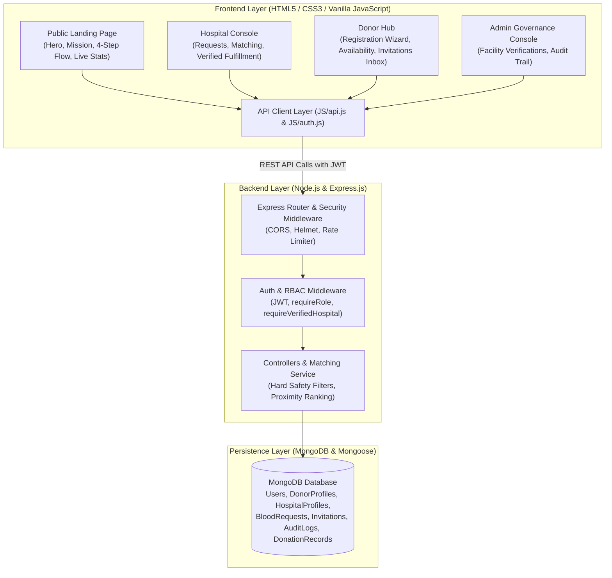

# 🩸 LifeLink — Smart Blood Donation & Coordination Platform

> *"Bridging eligible blood donors with healthcare facilities through safe, explainable algorithmic coordination."*

---

## 📖 About LifeLink

**LifeLink** is a secure, full-stack blood donation coordination platform engineered with **Node.js, Express.js, MongoDB, Mongoose, HTML5, CSS3, and vanilla JavaScript (ES6+)**.

It connects three specialized interfaces through a single, securely guarded backend:
1. **Public Landing Page & Visitor Portal:** Modern, healthcare-themed entry page detailing LifeLink's mission, problem-versus-solution breakdown, 4-step coordination lifecycle, clinical safety disclaimers, and public calls-to-action for both volunteer donors and healthcare institutions.
2. **LifeLink Hospital Console:** Operational operations center for authorized hospital and blood-bank staff to broadcast blood coordination requests, review safety-cleared algorithmic donor matches, dispatch invitations, track donor responses in real-time, and log verified clinical fulfillments. Includes verification-status gatekeeping that blocks unapproved facilities until granted institutional authorization.
3. **LifeLink Donor Hub:** Donor-facing interface with backend authentication, availability status toggling (`available` vs. `paused`), invitation response inbox, and synchronized donation history with automated 90-day cooldown calculation.
4. **LifeLink Admin Governance Console:** Administrative dashboard allowing system admins to review pending healthcare facilities, approve or revoke institutional operating licenses, inspect cross-system audit logs, and oversee governance metrics.

---

## ⚕️ Clinical & Safety Posture

LifeLink is designed strictly as a **coordination and outreach platform**, not a clinical decision-making or transfusion clearance system:

> [!IMPORTANT]
> **Potential Donor Matches — Subject to Verification**
> Algorithmic matching provides preliminary logistical coordination assistance only and does not establish clinical compatibility, crossmatch clearance, or transfusion suitability. Qualified blood-bank and hospital laboratory personnel must conduct standard donor screening, infectious disease testing, and laboratory crossmatching under applicable national healthcare procedures.

---

## 🏗️ Architecture & Technology Stack



* **Frontend:** HTML5, CSS3, Vanilla ES6+ JavaScript (Zero React or framework dependencies).
* **Backend:** Node.js, Express.js REST API.
* **Database:** MongoDB with Mongoose object modeling.
* **Security & Auth:** Bcrypt password hashing ($10$ rounds), JSON Web Tokens (JWT), Role-Based Access Control (RBAC), Helmet security headers, CORS origin whitelisting, privacy masking (PII phone & patient name masking).

---

## 📁 Modular Directory Structure

```text
LIFELINK/
├── CSS/
│   ├── components/         # 11 modular stylesheets
│   │   ├── auth.css        # Authentication modal & forms
│   │   ├── chatbot.css     # In-app assistant styling
│   │   ├── contact.css     # Feedback and support form
│   │   ├── dashboard.css   # Dynamic stats, charts & role banners
│   │   ├── donors.css      # Donor directory & donor cards
│   │   ├── forms.css       # Form inputs & validation styling
│   │   ├── landing.css     # Public landing page layout & hero
│   │   ├── matcher.css     # Smart Matcher interface & explanations
│   │   ├── modals.css      # Popups, confirmation dialogs & alerts
│   │   ├── navbar.css      # Navigation bar & authentication status
│   │   └── requests.css    # Blood requests list & creation form
│   └── style.css           # Global design system, CSS variables & typography
├── JS/
│   ├── admin.js            # Admin console (hospital verification & audit log viewer)
│   ├── api.js              # Centralized fetch() REST client with JWT storage
│   ├── auth.js             # Authentication handlers (login, register, logout, modal)
│   ├── compatibility.js    # Biological compatibility tables (RBC, Plasma)
│   ├── config.js           # Client configuration
│   ├── dashboard.js        # Dynamic operational metrics sync & role banners
│   ├── donors.js           # Donor directory with live MongoDB queries & phone masking
│   ├── eligibility.js      # Preliminary clinical rules & cooldown enforcement
│   ├── inbox.js            # Donor invitation inbox & response actions
│   ├── matcher.js          # Algorithmic matching & explanation breakdown
│   ├── messages.js         # Contact & support handlers
│   ├── modals.js           # Modal dialog controllers
│   ├── navigation.js       # SPA tab switching & client-side route guards
│   ├── profile.js          # Donor profile & donation history modal
│   ├── requests.js         # Blood request creation & management
│   ├── script.js           # Client application bootstrapper
│   └── utils.js            # Window bindings & HTML sanitization
├── server/
│   ├── src/
│   │   ├── config/         # MongoDB connection lifecycle (db.js)
│   │   ├── controllers/    # Route controllers (auth, donor, request, hospital, matcher, invitation, notification)
│   │   ├── middleware/     # Auth, RBAC, requireVerifiedHospital, and centralized error handler
│   │   ├── models/         # 8 Mongoose schemas (User, DonorProfile, HospitalProfile, BloodRequest, Invitation, DonationRecord, Notification, AuditLog)
│   │   ├── routes/         # Modular REST endpoints
│   │   ├── services/       # Safety-first algorithmic matcher service
│   │   ├── utils/          # Logger & synthetic demo data seeder
│   │   ├── app.js          # Express app configuration & middleware
│   │   └── server.js       # Server entrypoint with graceful shutdown
│   └── tests/              # Automated integration test suites (68 tests, 100% pass)
│       ├── auth.test.js                 # 8 Authentication & RBAC tests
│       ├── donor.test.js                # 10 Donor Directory, Ownership & Privacy tests
│       ├── hospital_requests.test.js    # 13 Request Lifecycle, Verification & Security tests
│       ├── matcher.test.js              # 11 Smart Matcher, Safety Filters & Disclaimer tests
│       ├── invitations.test.js          # 15 Outreach, Inbox Isolation & Sync tests
│       └── notifications_escalation.test.js # 11 Notifications & Deadline Escalation tests
├── index.html              # Unified Single Page Application shell
├── package.json            # NPM dependencies and test scripts
├── .env.example            # Environment configuration template
└── .gitignore              # Protected credential & dependency exclusions
```

---

## 🚀 Getting Started

### 1. Prerequisites
* **Node.js** v18+ or v20+ installed.
* **MongoDB** (running locally on port `27017` or a MongoDB Atlas connection string).

### 2. Installation
Clone the repository and install dependencies:
```bash
git clone https://github.com/your-username/LIFELINK.git
cd LIFELINK
npm install
```

### 3. Environment Configuration
Create your `.env` file from the provided `.env.example`:
```bash
cp .env.example .env
```
Ensure your `.env` contains:
```env
PORT=5000
NODE_ENV=development
MONGODB_URI=mongodb://127.0.0.1:27017/lifelink
JWT_SECRET=lifelink_dev_secret_key_2026_super_secure_node_jwt
JWT_EXPIRES_IN=7d
CLIENT_ORIGIN=http://127.0.0.1:5500,http://localhost:5500,http://localhost:5000
```

### 4. Seed Synthetic Demonstration Data
Populate realistic, clearly labeled synthetic healthcare scenarios:
```bash
npm run seed
```

### 5. Database Backup & Disaster Recovery
Create and restore timestamped JSON snapshots of all 8 MongoDB collections:
```bash
npm run db:backup         # Exports snapshot to server/backups/
npm run db:restore        # Restores latest backup snapshot
```

### 6. Running the Application
* **Development Mode (with Nodemon hot-reload):**
  ```bash
  npm run dev
  ```
* **Production Mode:**
  ```bash
  npm start
  ```
The platform is accessible at:
* **Frontend Portal & Public Landing:** `http://localhost:5000`
* **API Health Check:** `http://localhost:5000/api/health`

---

## 🧪 Automated Testing Suite

LifeLink includes a full automated integration and end-to-end test suite covering **91 test scenarios** across 7 domain suites with a **100% pass rate**:

```bash
npm test
```

Individual suites can also be executed independently:
```bash
npm run test:auth          # 8 Authentication & RBAC tests
npm run test:donor         # 10 Donor Directory, Ownership & Privacy tests
npm run test:hospital      # 13 Hospital Console & Request Operations tests
npm run test:matcher       # 11 Smart Matcher & Safety Filter tests
npm run test:invitations   # 15 Outreach & Response Synchronization tests
npm run test:notifications # 11 Notifications & Escalation tests
npm run test:e2e           # 23 Full Production Lifecycle & Security tests
```

---

## 📡 REST API Reference

### 🔐 Authentication (`/api/auth`)
| Method | Endpoint | Access | Description |
| :--- | :--- | :--- | :--- |
| `POST` | `/api/auth/register` | Public (Rate-Limited) | Register a new user (`donor` or `hospital`). Prevents unauthorized public admin self-assignment (403). |
| `POST` | `/api/auth/login` | Public (Rate-Limited) | Authenticate credentials and receive a signed Bearer JWT with user role and profile. |
| `POST` | `/api/auth/forgot-password` | Public (Rate-Limited) | Request secure token-based password reset. Enumeration-resistant response. |
| `POST` | `/api/auth/reset-password` | Public (Rate-Limited) | Complete password reset using SHA-256 hashed token with 1-hour expiry. |
| `GET` | `/api/auth/me` | Bearer Token | Retrieve authenticated user profile and account details. |
| `POST` | `/api/auth/logout` | Bearer Token | Invalidate session client-side and log event. |
| `GET` | `/api/auth/users` | Admin Only | Administrative user directory with role and status filters. |
| `PATCH` | `/api/auth/users/:id/status` | Admin Only | Administrative user account suspension or reactivation with logged reason. |

### 🩸 Blood Requests (`/api/requests`)
| Method | Endpoint | Access | Description |
| :--- | :--- | :--- | :--- |
| `POST` | `/api/requests` | Verified Hospital / Admin | Broadcast a blood coordination request (1–20 units, urgency, forward deadline). Anonymous demo hospital fallback removed. |
| `GET` | `/api/requests` | Public (Masked) / Auth | Retrieve requests filtered by urgency, blood group, zone, or status. Non-owning viewers receive masked patient initials and zone. |
| `GET` | `/api/requests/:id` | Public (Masked) / Auth | Retrieve single request with linked invitation history. |
| `PATCH` | `/api/requests/:id` | Owning Hospital / Admin | Edit permitted fields on open requests. Enforces institutional ownership (403 on foreign request). |
| `POST` | `/api/requests/:id/fulfill` | Owning Hospital / Admin | **Mandatory Outcome Verification:** Mark request fulfilled, log verified units, create official `DonationRecord`, and advance donor cooldown clock. |
| `POST` | `/api/requests/:id/cancel` | Owning Hospital / Admin | Cancel request and cascade cancellation to active invitations. |
| `DELETE` | `/api/requests/:id` | Admin Only | Administrative request deletion. Non-admin deletion attempts return 403. |

### 👥 Donors (`/api/donors`)
| Method | Endpoint | Access | Description |
| :--- | :--- | :--- | :--- |
| `GET` | `/api/donors` | Public (Masked) / Auth | Query donor directory (search, bloodGroup, zone, eligibility). Phone numbers masked for public visitors (`+91 98****344`). |
| `GET` | `/api/donors/:id` | Authenticated | Retrieve full donor profile with donation history and cooldown status. |
| `POST` | `/api/donors/register-wizard` | Public | Submit 10-step registration wizard directly to MongoDB; creates linked `User` and `DonorProfile`. |
| `PATCH` | `/api/donors/:id/availability` | Owning Donor / Admin | Update self-reported availability (`available`, `paused`, etc.). Cross-donor modifications return 403. |
| `POST` | `/api/donors/:id/donations` | Authenticated | Record donation history (distinguishes self-reported vs. verified institutional records). |
| `DELETE` | `/api/donors/:id` | Owning Donor / Admin | Delete profile and associated records. |

### âš¡ Smart Matcher (`/api/matcher`)
| Method | Endpoint | Access | Description |
| :--- | :--- | :--- | :--- |
| `POST` | `/api/matcher/find-matches` | Verified Hospital / Admin | Run safety-first algorithm. Returns ranked potential matches with justifications and mandatory clinical disclaimers. |
| `GET` | `/api/matcher/request/:requestId` | Verified Hospital / Admin | Run matching directly against an existing database request. |

### 📨 Invitations & Coordination (`/api/invitations`)
| Method | Endpoint | Access | Description |
| :--- | :--- | :--- | :--- |
| `POST` | `/api/invitations/send` | Verified Hospital / Admin | Dispatch invitation for an owned request. Compound index prevents duplicate active invitations (409 Conflict). |
| `GET` | `/api/invitations/request/:requestId` | Owning Hospital / Admin | Track all invitation states and responses for a request. Cross-hospital access returns 403. |
| `GET` | `/api/invitations/inbox` | Owning Donor / Admin | Strict donor inbox isolation. Donors only view invitations addressed directly to them. |
| `PATCH` | `/api/invitations/:id/respond` | Invited Donor / Admin | Submit donor response (`accepted` or `declined`) with optional note. Cross-donor hijacking returns 403. |

### 🏥 Hospital Operations & Governance (`/api/hospital`)
| Method | Endpoint | Access | Description |
| :--- | :--- | :--- | :--- |
| `GET` | `/api/hospital/dashboard-stats` | Public / Auth | Real-time counts computed from MongoDB records (scoped to own counts for hospitals; system totals for admin). |
| `GET` | `/api/hospital/list` | Admin Only | Retrieve list of registered healthcare facilities with pending and verified statuses. |
| `PATCH` | `/api/hospital/:id/verify` | Admin Only | Administrative workflow to grant `authorized_institution` or `unverified_demo` status. |
| `GET` | `/api/hospital/audit-logs` | Hospital / Admin | Scoped immutable audit trail (hospital staff views own actions; admin views system-wide logs). |

### 🔔 Notifications & Escalation (`/api/notifications`)
| Method | Endpoint | Access | Description |
| :--- | :--- | :--- | :--- |
| `GET` | `/api/notifications` | Authenticated | In-app notification feed with unread counts. |
| `PATCH` | `/api/notifications/:id/read` | Authenticated | Mark notification as read. |
| `PATCH` | `/api/notifications/mark-all-read` | Authenticated | Mark all notifications as read. |
| `POST` | `/api/notifications/check-escalation` | Authenticated | Evaluates deadlines, expires overdue requests, expires lingering invitations, and alerts on approaching deadlines. |

---

## 🎭 Step-by-Step Demonstration Walkthrough

Use this repeatable script to showcase LifeLink to prospective hospital partners and evaluators:

### Demo Accounts Seeded:
* **Authorized Hospital:** `hospital@citycare.org` / `HospitalSecurePass123!`
* **Unverified Hospital:** `clinic@metrocare.org` / `ClinicSecurePass123!`
* **Platform Admin:** `admin@lifelink.internal` / `AdminSecurePass123!`
* **Universal Donor (O-):** `aarav.donor@example.com` / `DonorSecurePass123!`
* **Eligible Donor (A+):** `priya.donor@example.com` / `DonorSecurePass123!`

### Walkthrough Sequence:
1. **Public Landing Page:** Open `http://localhost:5000`. Show the clean, trustworthy entry page with problem-vs-solution highlights, 4-step workflow, clinical disclaimer, and real-time MongoDB impact counts.
2. **Hospital Login & Verification Gating:** Log in as `clinic@metrocare.org`. The dashboard highlights the **Verification Pending** banner explaining that request creation is locked until an administrator reviews the facility.
3. **Admin Approval:** Log in as `admin@lifelink.internal` → navigate to **Admin Console** → locate the facility in the **Hospital Facilities** table → click **✓ Authorize**. The hospital is now `authorized_institution`.
4. **Emergency Blood Request Creation:** Log in as `hospital@citycare.org` → click **+ Create New Request** → broadcast an emergency request for `O-` units in `Zone A`.
5. **Smart Matching Execution:** Click **🔍 Find Donors** on the emergency request. Point out:
   * **Mandatory Medical Disclaimer:** *"Potential Donor Matches — Subject to Verification"*.
   * **Hard Safety Filters:** Ineligible donors (paused status, cooldown active) are excluded.
   * **Score Breakdown:** Click **Why Matched?** to display plain-language justifications (Compatibility, Availability, Zone Proximity, Urgency boost).
6. **Invitation Dispatch:** On the top-ranked match card (`Aarav Sharma [Synthetic]`), click **📨 Send Invitation**. The status transitions from `open` to `coordinating`, and a database invitation is created.
7. **Donor Response (Accept / Decline):** Log in as `aarav.donor@example.com` → navigate to **📬 Inbox**. View the invitation details and click **✓ Accept**.
8. **Hospital Synchronization & Verified Fulfillment:** Switch back to the hospital console. The invitation displays `accepted`. Click **Fulfill Request** to record received units and clinical notes. The donor's cooldown automatically resets to 90 days.
9. **Audit Trail Verification:** In the Admin Console, review the immutable audit trail verifying the complete lifecycle (`REQUEST_CREATED` → `DONOR_INVITATION_SENT` → `INVITATION_RESPONDED` → `REQUEST_FULFILLED`).

---

## 🚢 Deployment Guidelines

### Frontend Hosting
* The frontend uses pure HTML5, CSS3, and vanilla JS. Configure `API_BASE_URL` in `JS/api.js` to point to your live Express backend.

### Backend Hosting
* Deploy the Express server to a Node.js-compatible host (e.g. Render, Railway, Fly.io, AWS Elastic Beanstalk).
* Set production environment variables:
  * `NODE_ENV=production`
  * `MONGODB_URI=<Your MongoDB Atlas Connection String>`
  * `JWT_SECRET=<High-Entropy Cryptographic Secret>`
  * `CLIENT_ORIGIN=https://your-lifelink-frontend.com`

---

## 📜 License
This project is licensed under the ISC License.
